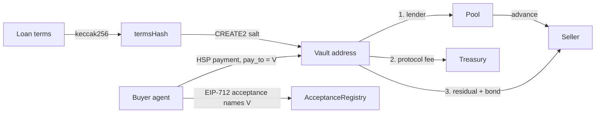

# Hundi

**Instant cash against accepted invoices, repaid automatically through HSP.**
HashKey Chain Horizon Hackathon, Track 2: Agent Payments & A2A Settlement.

A seller's agent issues an invoice. The buyer's agent checks it with deterministic rules and signs an
acceptance. A lending pool advances 90% to the seller in one transaction. At maturity the buyer's payment
lands in a per-invoice vault whose address was fixed before the loan was made, and the vault's code pays
the lender first, then the protocol fee, then the seller.

> **Live on HashKey Chain testnet (chain 133):** full lifecycle and five blocked attacks, every tx hash in
> [PROOF.md](PROOF.md). Vault `0xD7C2AB5c954ceb3e09f81eB596b0E73F02446B52`, pool `0x469946b530392428e96A89C2a2988402b9C78a33`.

> Prototype. No legal effect, no regulatory approval, not a TReDS replacement. See [CLAIMS.md](CLAIMS.md)
> for what is real, what is simulated and what is roadmap.

## The problem

Indian MSMEs are owed about ₹8.1 lakh crore in delayed payments [VERIFY: Economic Survey 2025-26 as
reported], and wait around 73 days for money legally due in 45 (vendor-sourced: Recordent). Invoice
discounting works (TReDS, regulated, onboarded buyers only), but it does not reach the long tail, and
cross-border export invoices settle naturally in stablecoins.

Two things make this hard to do with agents and HSP:

1. **Agents read untrusted text.** An invoice is counterparty data. A prompt hidden in an invoice must not be
   able to approve a payment. So Hundi's acceptance gate is code; an LLM may flag risk, never approve.
2. **HSP payments are final.** HSP settles one transfer to the cart's `pay_to`, with no escrow or splits
   [VERIFY]. So Hundi makes `pay_to` a vault whose code enforces the repayment order.

## The core insight



The vault address is a deterministic function of every loan term. Before lending anything, the pool can
check that the buyer has signed an acceptance naming that exact address, and that the only code that will
ever sit there repays the lender first. The buyer's agent, in turn, refuses any cart whose `pay_to` is not
the vault it accepted, so a payee swap fails even when the merchant signature is valid.

## Quick start (local chain, three commands)

Requires Node 22, pnpm 10 and Foundry.

```bash
git clone --recurse-submodules git@github.com:HarshitAnand1/hundi.git && cd hundi
pnpm install && pnpm test:all        # 75 contract + 51 SDK + 4 desk tests + 36-case eval
pnpm demo:local                      # anvil + mock token: lifecycle, 5 attacks, then the MCP server via a real MCP client
```

Watch it live: `pnpm -C apps/desk dev`, open http://localhost:8787, then run `pnpm e2e:local` again.

On HashKey Chain testnet: `cd contracts && DEPLOY_MOCK_TOKEN=true forge script script/Deploy.s.sol --rpc-url $RPC --broadcast --private-key $KEY`,
then from the root `RPC_URL=$RPC DEPLOYER_PRIVATE_KEY=$KEY HSK_CHAIN_ID=133 pnpm e2e`. Use a fresh burner key.

## Architecture

| Part | What it does |
| --- | --- |
| `contracts/src/AcceptanceRegistry.sol` | EIP-712 buyer acceptance; ERC-1271 smart wallets; nonce, expiry; each `(seller, buyer, invoiceNumber)` financeable once |
| `contracts/src/ReceivableFactory.sol` | `predictVault(terms)`; CREATE2 clone with salt = termsHash, only after a matching acceptance |
| `contracts/src/ReceivableVault.sol` | Open → Funded → Settled / Defaulted / Cancelled; lender-first waterfall, late interest, seller bond, default; push with pull fallback |
| `contracts/src/LiquidityPool.sol` | ERC-4626 pool; underwriter advances within on-chain bounds and per-buyer/seller caps; guardian can pause new advances only |
| `packages/sdk` | Canonical invoice hashing, EIP-712, money maths mirroring the vault, `verifyInvoice` (12 refusal codes), `verifyCart` (8 refusal codes) |
| `apps/desk` | Seller, logistics, buyer, underwriter, keeper and desk agents; journal + SSE; agent card |
| `apps/web` | Live timeline and waterfall dashboard |
| `packages/mcp` | MCP server (stdio): `issue_invoice`, `accept_invoice`, `request_advance`, `pay_invoice`, `get_receivable`, `list_receivables` |
| `eval/` | 36-case adversarial answer key for the acceptance gate, and its scored runner |
| `scripts/e2e.ts` | The lifecycle and attacks against any deployed chain |

Worked example (HANDOFF 5.4): a $10,000 invoice due in 73 days, 90% advance, 8% p.a. fee, 2% bond.
The seller gets $8,820 at funding; at maturity the lender receives $9,144, the protocol $10 and the seller
$846 plus the $180 bond back. Cost to the seller: about $154 instead of a 73-day wait. The e2e run asserts
these numbers against the chain.

## HSP integration, honestly

**What the official HSP Agentic Payment guide confirms (QA, revision 2026-10-30).** HSP is exposed as an MCP
server (Streamable HTTP, `https://mcp-qa.hashkeymerchant.com/`) with eight tools: `get_chain_config`,
`create_order`, `get_order`, `prepare_payment`, `finalize_payment`, `estimate_fee`, `submit_payment`,
`query_payment`. Orders take a caller-supplied `pay_to` (the server writes it into every x402 v2 payment
method). The payer signs an EIP-3009 `TransferWithAuthorization` or Permit2 `PermitTransferFrom`, and the
gateway broadcasts it. This is exactly the shape Hundi needs: `create_order(pay_to = vault)`.

**How Hundi plugs in (designed, not yet run against HSP).**
1. Desk calls `create_order` with `pay_to` = the CREATE2 vault from the stored acceptance and
   `merchant_name` = the team name.
2. Buyer agent calls `prepare_payment`, then runs the same deterministic check as `verifyCart` on what HSP
   returns: `pay_to` must equal the accepted vault, the token must be the configured USDC.e from
   `get_chain_config`, and `token_total_raw` must equal the amount due (plus gas only when
   `gas_fee_advanced` is false). Anything else is refused before the wallet signs.
3. Wallet signs the returned EIP-712 data; `finalize_payment` then `submit_payment`; `query_payment` until
   `payment-finalized`; then the keeper calls the vault's permissionless `settle()`.

**Why it is not live in this submission.** HSP QA requires IP allowlisting through the organisers' form, with
email confirmation. Our request was not confirmed before the deadline (the endpoint returns a Cloudflare
block for our IP), so the demo runs in labelled `HSP_MODE=self-relay`: the buyer wallet transfers USDC.e to
the vault only after `verifyCart` passes.

**Earlier notes (kept for the record):**

- **Built:** the cart check that HSP needs (`verifyCart`: signature, hash, `pay_to` = accepted vault, amount,
  token, due date, vault state), with HSP's hashing and ES256K verification injected behind an interface.
- **Running today:** `HSP_MODE=self-relay`. The desk signs carts with Hundi's own labelled scheme, and the
  buyer's wallet transfers USDC.e to the vault only after `verifyCart` passes.
- **Not yet:** the HSP gateway adapter (merchant API, webhook, relayer check). It waits on organiser
  credentials and the confirmed wire format; the webhook endpoint returns 501 rather than trust
  unauthenticated payloads.

## Security and rigor

- Foundry: unit tests for every revert path, waterfall fuzzing, 6 invariants (value conservation, single
  financing per termsHash, lender paid before protocol and seller, bounded advances, monotonic state, pool
  accounting), cross-language test vectors.
- SDK: every refusal code has a test, plus prompt injection, payee swap, tampered cart, failing dependencies.
- Live e2e: duplicate invoice blocked by the agent and, with the agent bypassed, by the chain.
- Eval: 36 adversarial and benign invoices (prompt injection, BEC payee swaps, duplicates, inflated amounts,
  forged signatures, schema smuggling, policy edges). **36/36 exact, 0 false accepts, 0 false refusals**:
  [eval/RESULTS.md](eval/RESULTS.md).
- Slither 0.11.3: 22 results, all triaged, no exploitable issue: [AUDIT.md](AUDIT.md).
- The LLM boundary: no model output can approve anything. See `packages/sdk/src/verifyInvoice.ts`.

Not done yet: an independent human audit.

## Limitations

One merchant of record for all sellers. Delivery proof is a signed attestation from a simulated logistics
agent. Demo role wallets are derived from one operator key. Pool solvency rests on caps, bounds and the
bond, not on credit scoring. Stablecoin settlement does not remove rupee FX exposure.

## Use it from your own agent (MCP)

```json
{ "mcpServers": { "hundi": { "command": "pnpm", "args": ["-s", "-C", "/path/to/hundi", "mcp"],
  "env": { "RPC_URL": "…", "DEPLOYER_PRIVATE_KEY": "<burner>" } } } }
```

Any MCP client can then issue, accept, finance, pay and inspect receivables. The acceptance and cart gates
still run in code, so a calling model can ask but cannot make a refused invoice pass.

## Roadmap

HSP gateway adapter; MCP over HTTP; GST e-invoice / e-way bill evidence instead of simulated delivery;
per-seller merchants; transferable receivables; licensed lending partners.

## Licence

MIT.
